<!-- Generated by scripts/lib/render.mjs from data/profile.json. See docs/MAINTAINING.md. -->

<a href="https://github.com/RajatBhardwaj2006">
  <picture>
    <source media="(max-width: 600px)" srcset="assets/generated/hero-mobile.svg">
    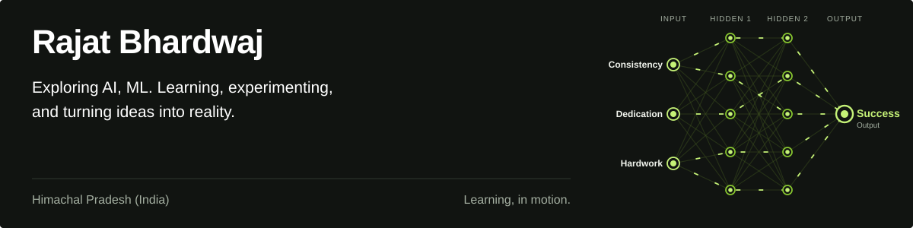
  </picture>
</a>

 &nbsp;  &nbsp;  &nbsp; 

<picture><source media="(max-width: 600px)" srcset="assets/generated/metrics-mobile.svg">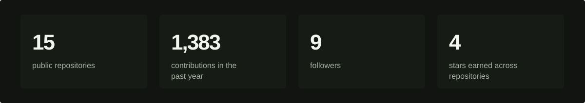</picture>

## Featured Projects

Featured from my GitHub pins.

  <a href="https://github.com/RajatBhardwaj2006/Artificial-Intelligence-and-Machine-Learning"><picture><source media="(max-width: 600px)" srcset="assets/generated/project-1-mobile.svg">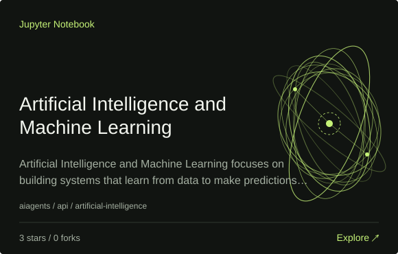</picture></a>
  <a href="https://github.com/RajatBhardwaj2006/Smart-Medication-Management-Health-Assistant"><picture><source media="(max-width: 600px)" srcset="assets/generated/project-2-mobile.svg"></picture></a>

  <a href="https://github.com/RajatBhardwaj2006/VisionInspect-Industrial-Defect-Detection-"><picture><source media="(max-width: 600px)" srcset="assets/generated/project-3-mobile.svg">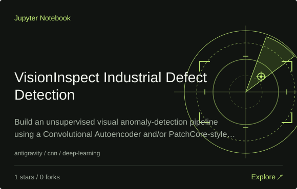</picture></a>
  <a href="https://github.com/RajatBhardwaj2006/Fraudulent-Online-Transaction-Detection-System"><picture><source media="(max-width: 600px)" srcset="assets/generated/project-4-mobile.svg">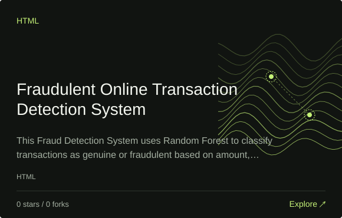</picture></a>

  <a href="https://github.com/RajatBhardwaj2006/Quick-Attendance"><picture><source media="(max-width: 600px)" srcset="assets/generated/project-5-mobile.svg">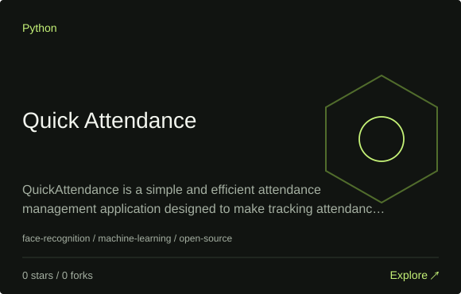</picture></a>
  <a href="https://github.com/RajatBhardwaj2006/NeuralView"><picture><source media="(max-width: 600px)" srcset="assets/generated/project-6-mobile.svg">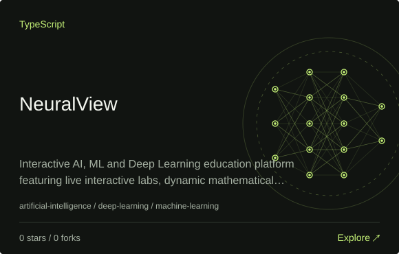</picture></a>

Project links and descriptions

- [Artificial-Intelligence-and-Machine-Learning](https://github.com/RajatBhardwaj2006/Artificial-Intelligence-and-Machine-Learning): Artificial Intelligence and Machine Learning focuses on building systems that learn from data to make predictions and decisions. This course covers statistics, data preprocessing, supervised & unsupervised learning, neural networks & modern AI techniques like deep learning and NLP, with practical implementation using Python & AI development tools
- [Smart-Medication-Management-Health-Assistant](https://github.com/RajatBhardwaj2006/Smart-Medication-Management-Health-Assistant): The system helps users search medicines, view medicine details, receive AI-based health suggestions, request unavailable medicines, and allows administrators to manage inventory, sales, and customer requests efficiently.
- [VisionInspect-Industrial-Defect-Detection-](https://github.com/RajatBhardwaj2006/VisionInspect-Industrial-Defect-Detection-): Build an unsupervised visual anomaly-detection pipeline using a Convolutional Autoencoder and/or PatchCore-style feature-based anomaly detection. The system should learn primarily from defect-free images and generate an anomaly score, normal/abnormal decision, and visual anomaly heatmap for test images.
- [Fraudulent-Online-Transaction-Detection-System](https://github.com/RajatBhardwaj2006/Fraudulent-Online-Transaction-Detection-System): This Fraud Detection System uses Random Forest to classify transactions as genuine or fraudulent based on amount, frequency, and location. Built with Python and Flask, it provides a web interface for instant predictions.
- [Quick-Attendance](https://github.com/RajatBhardwaj2006/Quick-Attendance): QuickAttendance is a simple and efficient attendance management application designed to make tracking attendance faster and easier. With a clean interface and intuitive features, it helps users manage attendance records and stay organized without unnecessary complexity.
- [NeuralView](https://github.com/RajatBhardwaj2006/NeuralView): Interactive AI, ML and Deep Learning education platform featuring live interactive labs, dynamic mathematical visualizations, and real-time parameter tuning.

## Repositories & Tech Stack

> Click any badge below to explore the code.

### Artificial Intelligence & Machine Learning

### DSA & Problem Solving

### Languages

### AI Engineering & Development

### Frontend

### Development Tools

### Libraries

## The code behind the work

  <picture>
    <source media="(max-width: 600px)" srcset="assets/generated/languages-mobile.svg">
    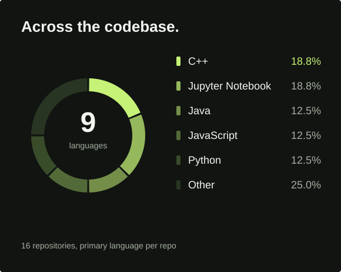
  </picture>
  <picture>
    <source media="(max-width: 600px)" srcset="assets/generated/commits-mobile.svg">
    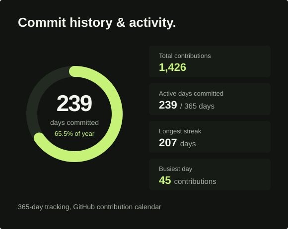
  </picture>

Language data

Each owned public repository counts once, using its primary language reported by GitHub. Forks and repositories with no detected language are excluded. These proportions describe the repositories, not proficiency.

| Language | Repositories | Share |
| :--- | ---: | ---: |
| C++ | 3 | 18.8% |
| Jupyter Notebook | 3 | 18.8% |
| Java | 2 | 12.5% |
| JavaScript | 2 | 12.5% |
| Python | 2 | 12.5% |
| C | 1 | 6.3% |
| Go | 1 | 6.3% |
| HTML | 1 | 6.3% |
| TypeScript | 1 | 6.3% |

## Showing up, day after day

<a href="https://github.com/RajatBhardwaj2006?tab=overview">
  <picture>
    <source media="(max-width: 600px)" srcset="assets/generated/contributions-mobile.svg">
    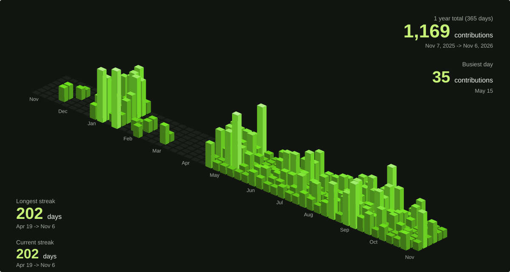
  </picture>
</a>

Contribution data and recent repositories

1,161 contributions across 233 active days between 02 Nov 2025 and 05 Nov 2026. Longest streak within this window: 201 days. Best day: 35 contributions.

- [NeuralView](https://github.com/RajatBhardwaj2006/NeuralView) · pushed 05 Nov 2026
- [Java](https://github.com/RajatBhardwaj2006/Java) · pushed 31 Oct 2026
- [Smart-Medication-Management-Health-Assistant](https://github.com/RajatBhardwaj2006/Smart-Medication-Management-Health-Assistant) · pushed 31 Oct 2026

Daily counts follow GitHub's contribution calendar visibility and counting rules. Private repository names and content are never requested or published.

<picture><source media="(max-width: 600px)" srcset="assets/generated/activity-mobile.svg">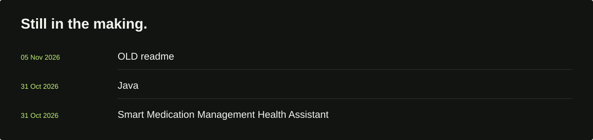</picture>

<a href="https://github.com/RajatBhardwaj2006?tab=repositories"><picture><source media="(max-width: 600px)" srcset="assets/generated/footer-mobile.svg"></picture></a>

GitHub snapshot · 2026-11-05 13:13:13 UTC · refreshed every 6 hours by [GitHub Actions](https://github.com/RajatBhardwaj2006/RajatBhardwaj2006/actions/workflows/sync-profile.yml). [Data & maintenance](docs/MAINTAINING.md)
